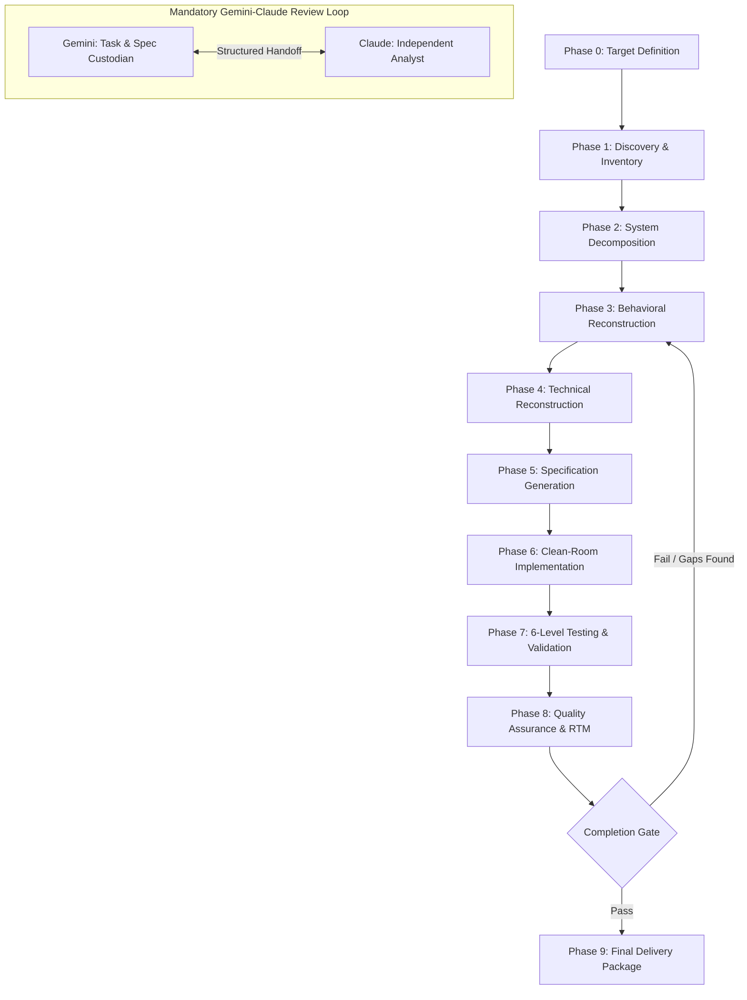

# Universal Reverse Engineering Engine (UREE)

An evidence-driven, dual-agent engineering framework for systematically reverse-engineering software systems, APIs, web applications, protocols, data pipelines, and AI workflows.

UREE pairs **Gemini** (Master Orchestrator & Specification Custodian) with **Claude** (Independent Analytical & Adversarial Engineering Agent) inside a deterministic, 10-phase gated pipeline.

## Core Principles

1. **Evidence Over Intuition:** Every architectural or behavioral claim must link to an immutable Evidence ID (`EV-XXX`) and carry an explicit confidence rating (`C1` to `C0`).
2. **Behavioral Before Technical:** Reconstruct *what* the system does (black-box I/O and state transitions) before modeling *how* it does it internally.
3. **Adversarial Verification:** Neither agent trusts unverified assumptions. Every phase requires structured cross-examination before advancing.
4. **6-Level Validation:** No reconstruction is marked complete without static, unit, integration, end-to-end, regression, and differential verification.
5. **Authorized Scope Only:** Built strictly for clean-room reconstruction, legacy modernization, interoperability, and authorized security/system audits.

## Pipeline Architecture



## Quickstart

### 1. Clone the Repository
```bash
git clone https://github.com/Satna-Project/universal-reverse-engineering-engine.git
cd universal-reverse-engineering-engine
```

### 2. Scaffold a New Target Workspace
Run the initialization script to create an isolated workspace pre-populated with evidence logs, handoff payloads, and specification templates:
```bash
chmod +x scripts/init_workspace.sh
./scripts/init_workspace.sh my-target-system
```

### 3. Initialize the Dual Agents
* **Agent 1 (Gemini):** Load `prompts/gemini_orchestrator.md` as the system prompt in your Gemini workspace.
* **Agent 2 (Claude):** Load `prompts/claude_analyst.md` as the system prompt in your Claude workspace.

### 4. Execute Phase 0
Fill out `workspaces/my-target-system/00_target_definition.md` with your available artifacts and pass it to Gemini to generate the initial Evidence Register (`EV-001`...`EV-00N`) and the first Claude handoff payload.

## Confidence Classification Tiers

| Tier | Label | Definition |
| :--- | :--- | :--- |
| **C1** | Confirmed | Directly observed in source code, config files, or deterministic execution logs. |
| **C2** | High-Confidence Inference | Strongly implied by API contracts, boundary behavior, or framework conventions. |
| **C3** | Speculative Inference | Black-box behavioral approximation where internal mechanics remain opaque. |
| **C0** | Unknown / Blocked | Insufficient evidence to model; requires targeted artifact extraction. |

## Repository Contents

* `prompts/gemini_orchestrator.md` — Master System Prompt for Gemini (Orchestrator).
* `prompts/claude_analyst.md` — Companion System Prompt for Claude (Independent Analyst).
* `profiles/domain_routing_profiles.md` — Specialized inspection matrices across 5 target categories.
* `templates/` — Standardized Markdown documents for Target Definition, Evidence Register, Agent Handoffs, 15-Section Specification, and Requirement Traceability Matrix (RTM).
* `scripts/init_workspace.sh` — CLI utility to scaffold new reverse-engineering target folders.

## License

Released under the MIT License. See `LICENSE` for details.
